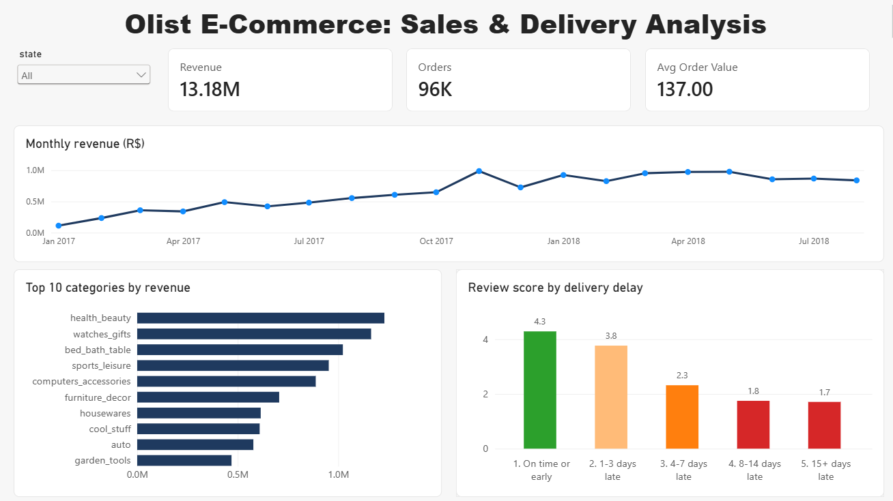
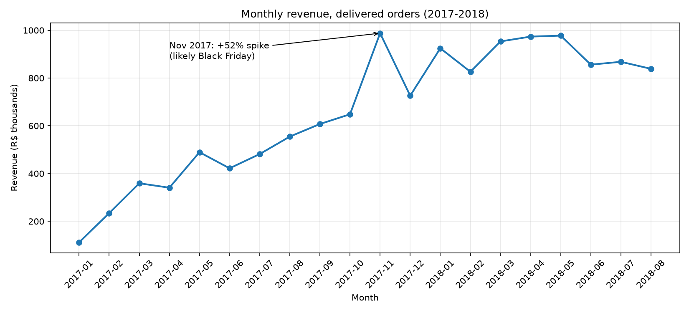
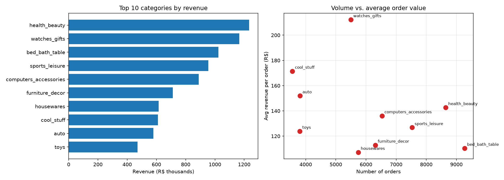
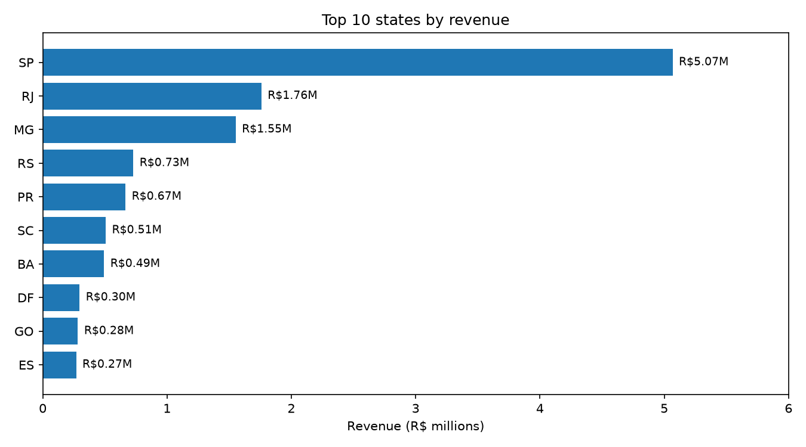
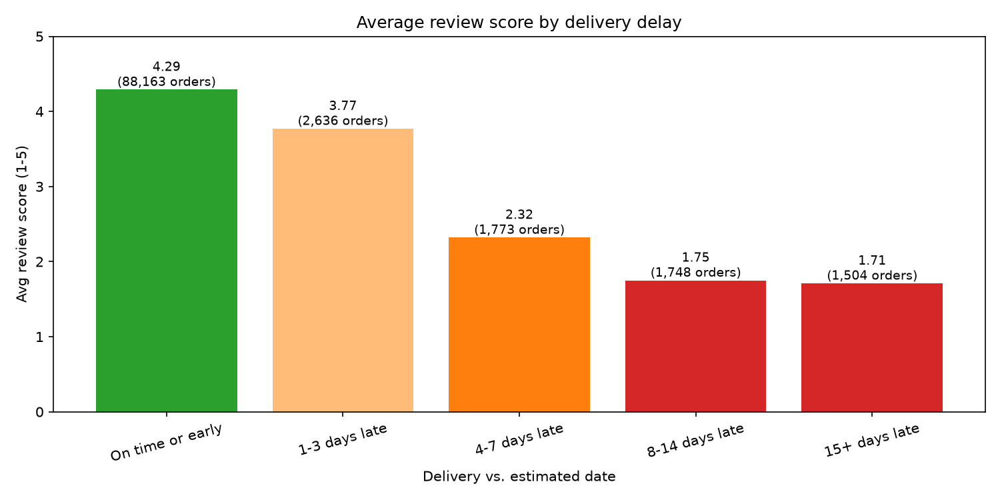

# Olist E-Commerce: Sales & Delivery Analysis



**In short:** Revenue grew about 6x through 2017 and settled near R$0.83M-0.98M a month in 2018. Three states (SP, RJ, MG) bring in about 63% of revenue. Late deliveries are tied to much lower review scores, and the damage jumps sharply once an order is 4 or more days late.

## Business questions

1. How has monthly revenue trended, and where are the peaks and dips?
2. Which product categories and states generate the most revenue, and which have the highest average order value?
3. Do late deliveries lower review scores, and from what point?

## Key findings

### 1. Revenue grew fast in 2017, then levelled off

Monthly revenue rose from about R$112K in January 2017 to about R$648K in October 2017. November 2017 was the peak (**R$988K, +52% on the month, 7,289 orders**), most likely driven by Black Friday. December fell 26%, but 2018 stayed well above pre-peak levels at roughly R$830K-980K a month.



### 2. Revenue is concentrated in a few categories and states

The top 10 categories make up about 62% of revenue. **health_beauty** leads (R$1.23M, 9.3%), followed by **watches_gifts** (R$1.17M) and **bed_bath_table** (R$1.02M). Categories win in different ways: bed_bath_table on volume (9,272 orders, about R$110 per order) and watches_gifts on order value (about R$212 per order, 5,495 orders). **Sao Paulo (SP) alone is about 38% of revenue** (R$5.07M); SP, RJ and MG together are about 63%.

 

### 3. Late delivery is linked to much lower reviews, with a cliff at 4+ days

Only 6.7% of orders arrive late (6,381 of 95,824), but they average a **2.27** review score against **4.29** for on-time orders. A delay of 1-3 days costs about half a point (3.77). At 4-7 days the score falls to 2.32, and beyond 8 days it bottoms out near 1.7.

| Delivery vs. estimate | Orders | Avg review score |
|---|---:|---:|
| On time or early | 88,163 | 4.29 |
| 1-3 days late | 2,636 | 3.77 |
| 4-7 days late | 1,773 | 2.32 |
| 8-14 days late | 1,748 | 1.75 |
| 15+ days late | 1,504 | 1.71 |



## Recommendations

- **Focus first on preventing 4+ day delays.** About 5,000 orders (5%) fall in this range and carry the lowest scores. Flagging at-risk orders early and reviewing the sellers and routes behind them is likely to pay off most.
- **Set more realistic delivery estimates.** Small misses (1-3 days) already cost about half a review point, and a more cautious estimate is a cheap fix.
- **Plan inventory and promotions around Q4.** November drives a large spike, and gift-type categories react strongly (watches_gifts roughly doubled from Q3 to Q4 2017).
- **Check delivery performance outside SP, RJ and MG.** Revenue is concentrated there, so growth elsewhere may depend on delivery reliability, which this analysis did not test by region.

## Limitations

- The delay-vs-review result shows an association, not proof of cause. It does not control for product category, region or seller.
- Revenue means item price on delivered orders only (freight and cancelled orders excluded). The monthly trend and dashboard start in January 2017; category, state and delivery queries cover all delivered orders, so small differences exist between them.
- The final months of the dataset may be incomplete, so a drop at the end is not necessarily a real decline.
- The delivery chart on the dashboard comes from a summary table and does not respond to the state filter.
- Amounts are in Brazilian reais (R$), and the data covers 2016-2018 from a single marketplace.

## Tools

- **SQL (SQLite):** joins, aggregation, window functions (LAG, running totals)
- **Python (pandas, matplotlib):** data loading, charts, automated pipeline
- **Excel:** pivot table of revenue by category and quarter, with a state filter
- **Power BI:** interactive dashboard (`dashboards/olist_dashboard.pbix`)

## Project structure

```
.
├── run_pipeline.py        # builds the database, runs the SQL, saves results and charts
├── requirements.txt
├── notebooks/             # exploratory analysis and charts
├── outputs/               # query results (CSV)
├── images/                # charts and dashboard screenshot
├── dashboards/            # Power BI file
└── data/raw/              # Olist CSVs (not included, see below)
```

## How to run it

1. Download the [Brazilian E-Commerce Public Dataset by Olist](https://www.kaggle.com/datasets/olistbr/brazilian-ecommerce) from Kaggle and put its CSV files in `data/raw/`. The data is not included because of its size.
2. Install the libraries: `pip install -r requirements.txt`
3. Run the pipeline: `python run_pipeline.py`

The script loads the CSVs into SQLite, runs the queries, writes the result tables to `outputs/` and redraws the charts in `images/`. Use `python run_pipeline.py --rebuild` to rebuild the database from scratch.
